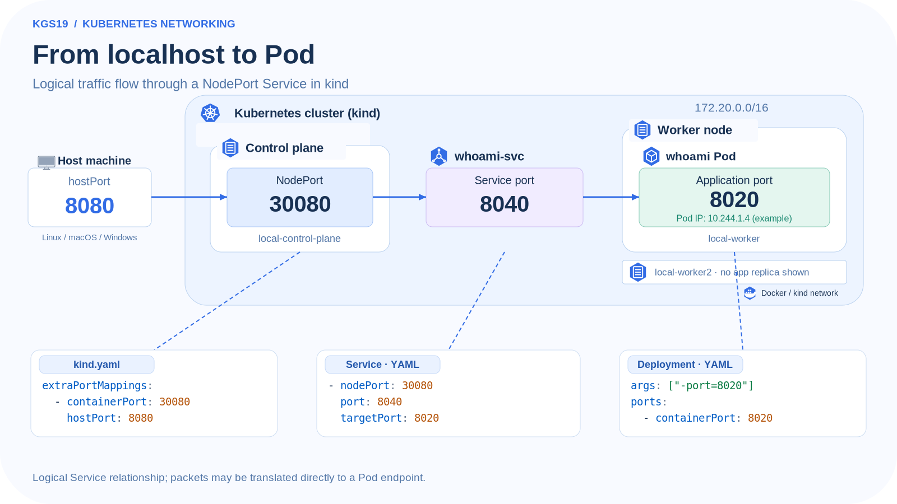
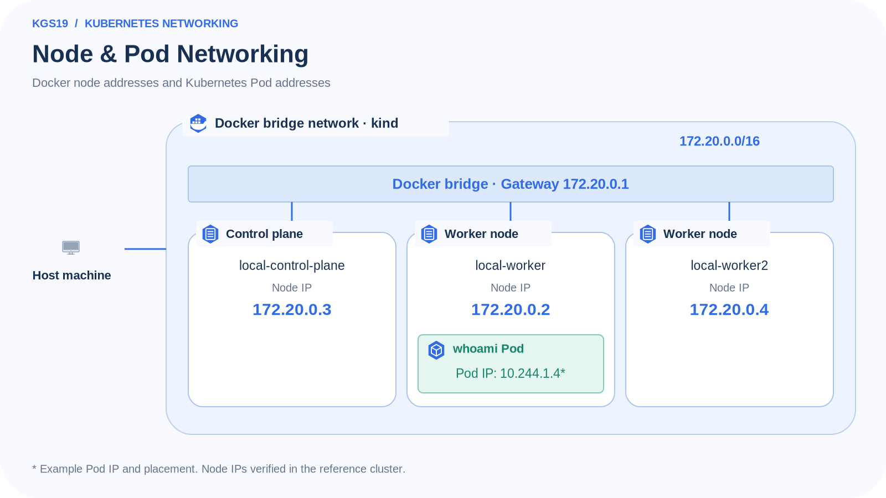
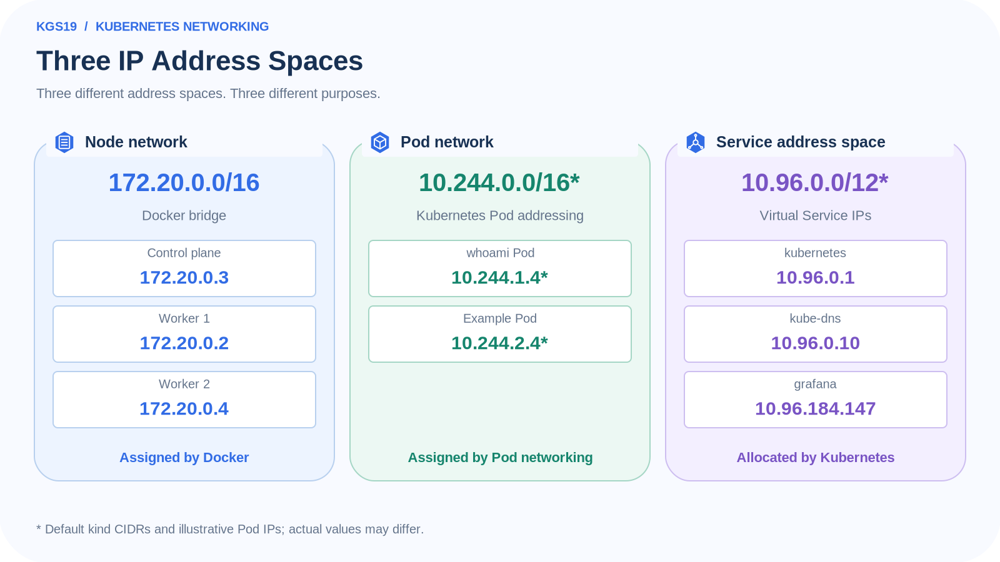

# Kind — Getting Started

A practical guide to setting up a local Kubernetes cluster using Kind for development, testing, and experimentation.


## 1. Prerequisites and installation

[Kind (Kubernetes in Docker)](https://kind.sigs.k8s.io/) runs Kubernetes nodes as containers. 
This guide uses Docker on macOS; install [Docker Desktop](https://docs.docker.com/desktop/setup/install/mac-install/) and start it first.

With [Homebrew](https://brew.sh/) installed:

```bash
brew install kind 
brew install kubectl
brew install derailed/k9s/k9s
```

- [Kind](https://kind.sigs.k8s.io/docs/user/quick-start/#installation): creates and deletes local clusters.
- [kubectl](https://kubernetes.io/docs/tasks/tools/install-kubectl-macos/): communicates with the Kubernetes API.
- [K9s](https://k9scli.io/topics/install/): optional interactive terminal UI for inspecting resources.
[k9s](https://github.com/derailed/k9s/releases): from github release page

Alternatively, download standalone executables using the official installation pages above. Select `darwin/arm64` for Apple Silicon or `darwin/amd64` for Intel (`uname -m` reports `arm64` or `x86_64`). Extract archives where necessary, then install each downloaded executable (named `kind`, `kubectl` or `k9s`) into a directory on your PATH, for example:

```bash
## kind
[ $(uname -m) = arm64 ] && curl -fLo ./kind https://github.com/kubernetes-sigs/kind/releases/latest/download/kind-darwin-arm64

## kubectl
curl -LO "https://dl.k8s.io/release/$(curl -L -s https://dl.k8s.io/release/stable.txt)/bin/darwin/arm64/kubectl"

## k9s [optinal]
curl -fLO "https://github.com/derailed/k9s/releases/latest/download/k9s_$(uname -s)_$(uname -m | sed -e 's/x86_64/amd64/' -e 's/aarch64/arm64/').tar.gz" 
tar -zxvf k9s_Darwin_arm64.tar.gz

## add execute permission
chmod +x kind
chmod +x kubectl
chmod +x k9s

## check the version
./kind version
./kubectl version
./k9s version

## Move the binaries to /usr/local/bin
## a standard directory typically included in PATH on macOS and Linux.
mv kind /usr/local/bin/kind
mv kubectl /usr/local/bin/kubectl
mv k9s /usr/local/bin/k9s

## Verify the location of the installed binaries: 
which kind
which kubectl
which k9s

## Finally, verify that Docker is running:
docker info
```

## 2. Create the cluster
Open [kind.yaml](kind.yaml). It defines a cluster named `local`, with one control-plane node and two worker nodes. 

- `Control plane` nodes are where the Kubernetes control plane components run, such as the API server. They can also run application workloads.
- `Worker` nodes are primarily responsible for running application workloads

The extra port mapping connects host port `8080` to port `30080` on the control-plane container(k8s node). We will revisit it in the networking section.
Ensure host port 8080 is free otheriwise set an other port


```bash
kind create cluster --config kind.yaml
kind get clusters
kubectl config current-context
cat ~/.kube/config | grep 'cluster:'
kubectl get nodes -o wide
docker ps
```

Use a fresh cluster named `local` and ensure host port 8080 is free. If a cluster with that name already exists, do not delete it unless you intend to lose its workloads. The expected kubectl context is `kind-local`; confirm it before deploying or deleting resources. Wait for all three nodes to become Ready. `docker ps` shows that the nodes are Docker containers.

## 3. Deploy Whoami

[Whoami](https://github.com/traefik/whoami) is a small HTTP application that returns information about the request and the container serving it.

Open [deployment.yaml](manifests/deployment.yaml). The Deployment requests one replica, uses the `traefik/whoami` image and configures the application to listen on port `8020`. The `containerPort` field documents that port; the argument actually configures the application listener.

Open [service.yaml](manifests/service.yaml). The Service selects Pods with `app: whoami` and exposes them using a NodePort. Its three port fields are explained below.

```bash
kubectl --context kind-local apply -f manifests/
kubectl --context kind-local rollout status deployment/whoami
kubectl --context kind-local get pods -o wide
kubectl --context kind-local get svc
```

Optionally inspect the Pod and Service interactively:

```bash
k9s --context kind-local
```

Use `:pods` and `:svc` to switch views; `:q` exits.

## 4. Access the application

Open [http://localhost:8080](http://localhost:8080) in your browser, or run:

```bash
curl http://localhost:8080
```

The response shows the serving container's hostname, IP addresses and HTTP request information. Compare the Pod IP with `kubectl get pods -o wide`. Exact values vary between clusters.

## 5. Understand the networking

The [editable draw.io file](diagrams/kind-networking.drawio) contains three tabs. The images below are derived from those pages.

### 5.1 From localhost to Pod



| Port | Meaning |
| --- | --- |
| 8080 | Host port used by the browser |
| 30080 | Kind container port and Kubernetes NodePort (must match for this mapping) |
| 8040 | Service port, used with its ClusterIP or DNS name inside the cluster |
| 8020 | Service targetPort and application listening port |

The diagram shows the logical relationship between the ports. NodePort traffic can be translated directly to a Pod endpoint; it does not have to traverse the ClusterIP and Service port as a separate packet hop.

### 5.2 Node and Pod networking



```bash
docker network inspect kind
kubectl --context kind-local get nodes -o wide
kubectl --context kind-local get pods -o wide
```

In the reference cluster, Docker assigned `172.20.0.3` to the control plane, `172.20.0.2` to the first worker and `172.20.0.4` to the second worker. The bridge subnet was `172.20.0.0/16`, with gateway `172.20.0.1`. These are examples from a real reference cluster, not fixed settings in `kind.yaml`. The Whoami Pod IP and placement are illustrative. Docker Desktop runs Linux containers inside a VM on macOS; the browser uses the published host port rather than needing direct access to the bridge.

### 5.3 Three IP address spaces



- **Nodes (blue):** Docker assigns node container IPs from its bridge network in this setup.
- **Pods (green):** Kubernetes Pod networking assigns workload IPs; Kind's default IPv4 Pod subnet is `10.244.0.0/16`.
- **Services (purple):** Kubernetes allocates virtual ClusterIPs from its Service address space; Kind's default IPv4 Service subnet is `10.96.0.0/12`. A ClusterIP is not a separate container or machine and normally remains stable for the lifetime of the Service.

```bash
kubectl --context kind-local get svc -A -o wide
```

The third diagram includes reference Service IPs (`kubernetes`, `kube-dns`, and `grafana`). Grafana is not installed by this tutorial; it is an example from the reference cluster. The default CIDRs have not been independently verified against that cluster. Per-node Pod CIDRs and IPv6 are intentionally omitted.

## 6. Delete the cluster

When you no longer need this disposable environment, delete it. This removes the cluster and its workloads; it is not a backup mechanism.

```bash
kind delete cluster --name local
```

To start again, repeat the cluster creation and application deployment steps.

## References

- [Kind configuration](https://kind.sigs.k8s.io/docs/user/configuration/)
- [Kubernetes Services](https://kubernetes.io/docs/concepts/services-networking/service/)
- [Kubernetes networking](https://kubernetes.io/docs/concepts/cluster-administration/networking/)
- [Service virtual IPs](https://kubernetes.io/docs/reference/networking/virtual-ips/)
- [Docker bridge networking](https://docs.docker.com/engine/network/drivers/bridge/)

Recording guide: [transcript.md](transcript.md).
